# Romanian Whist

A desktop version of [Romanian Whist](https://en.wikipedia.org/wiki/Romanian_whist), the
trick-taking card game where the whole point is to say exactly how many tricks you will take, then
take exactly that many. Play against computer opponents, or sit back and watch them play each other.

It runs on Linux, Windows and macOS, in English or Romanian.

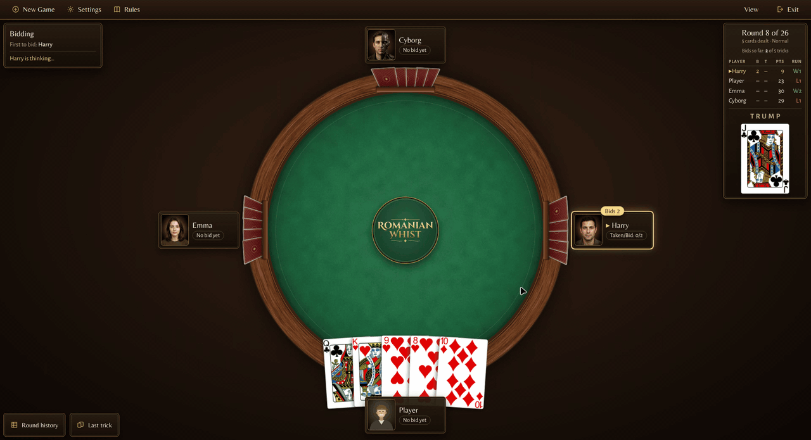

## Features

- **2 to 6 players** at a round table, with you and up to five computer opponents.
- **Nine computer opponents to choose from**, from one that plays a random legal card to Reckoners
  that imagine possible deals before every card. Each seat can play a different one.
- **Play or watch.** Take a seat, or watch a game between computer players.
- **Both game shapes:** 1-8-1 (one card up to eight and back down) and 8-1-8 (the other way round).
- **Forehead and hidden rounds.** In a forehead round you see everyone's card but your own; in a
  hidden round nobody sees anything before bidding. Add one of each at the end of the game, or
  play every one-card round forehead.
- **The rules are enforced for you.** Cards you may not play are greyed out, and the one bid the
  last bidder may not make is unavailable.
- **The score is always in view**, with each player's bid, tricks taken, points and streak, plus a
  full round-by-round history and the last trick on demand.
- **Pace it your way.** Set how quickly the computer players move, how fast cards animate, and
  whether the game waits for you after each round.
- **Fixed deals.** Give a seed to deal the same game again.
- **English and Romanian.**

## Screenshots

<table>
  <tr>
    <td width="50%">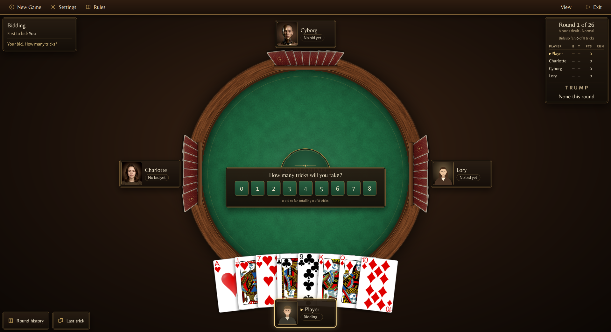</td>
    <td width="50%">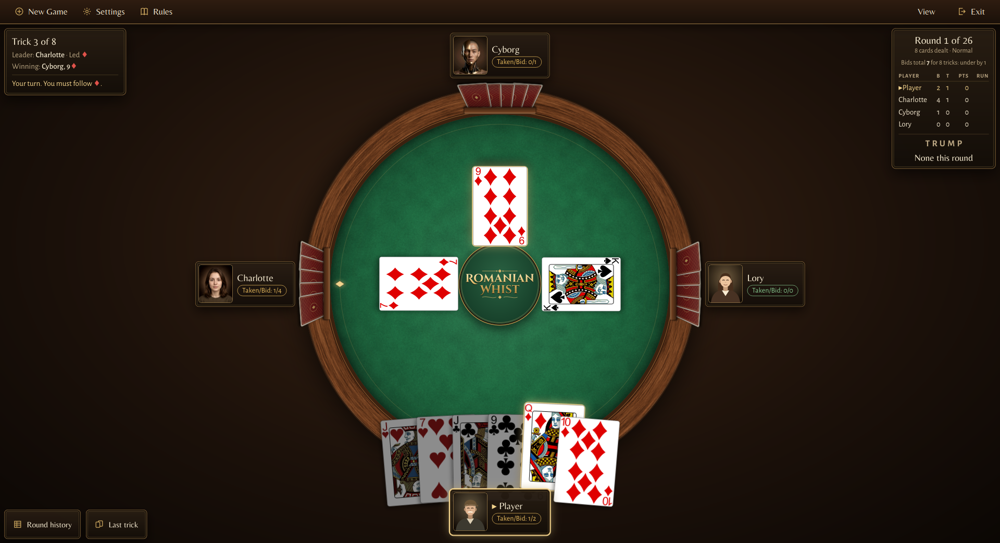</td>
  </tr>
  <tr>
    <td>Bidding: how many tricks will you take?</td>
    <td>Your turn: you must follow diamonds, so the other cards are greyed out.</td>
  </tr>
  <tr>
    <td>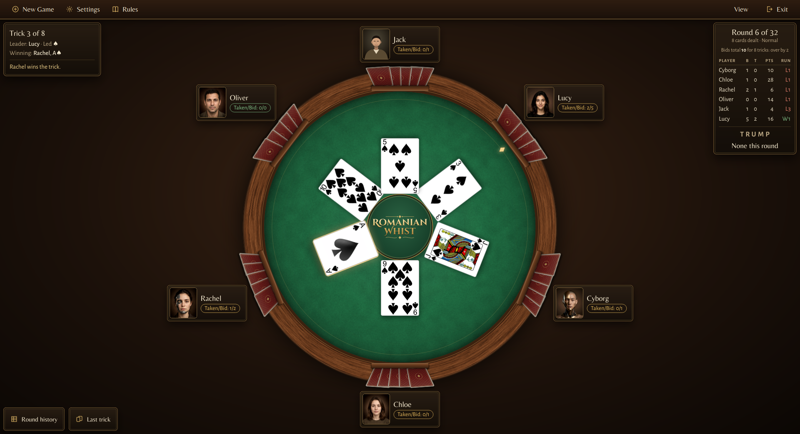</td>
    <td>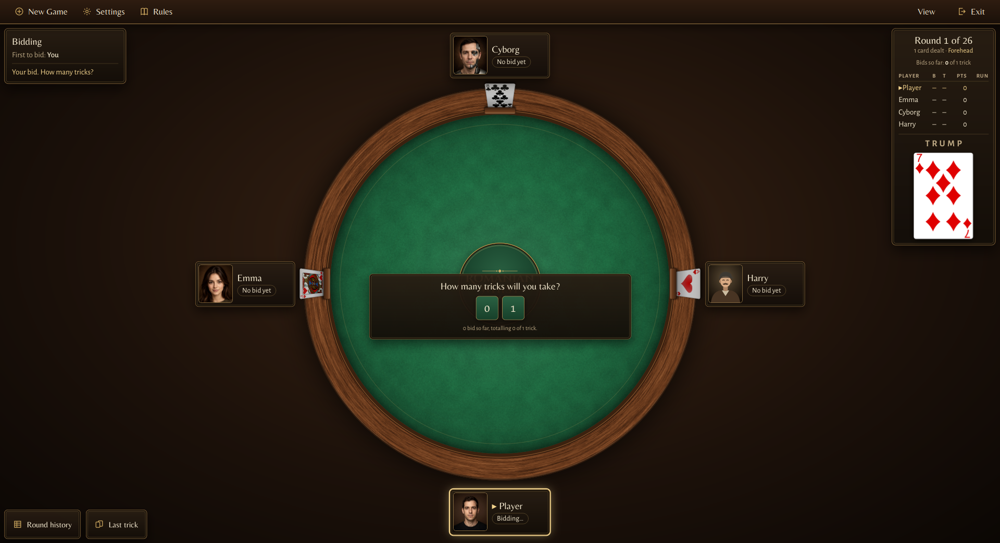</td>
  </tr>
  <tr>
    <td>Six players at the table.</td>
    <td>A forehead round: you see everyone's card but your own.</td>
  </tr>
  <tr>
    <td>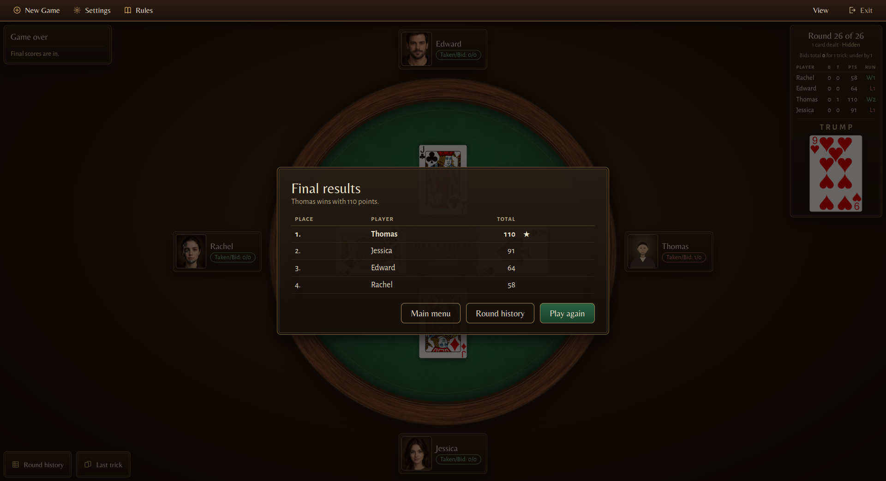</td>
    <td>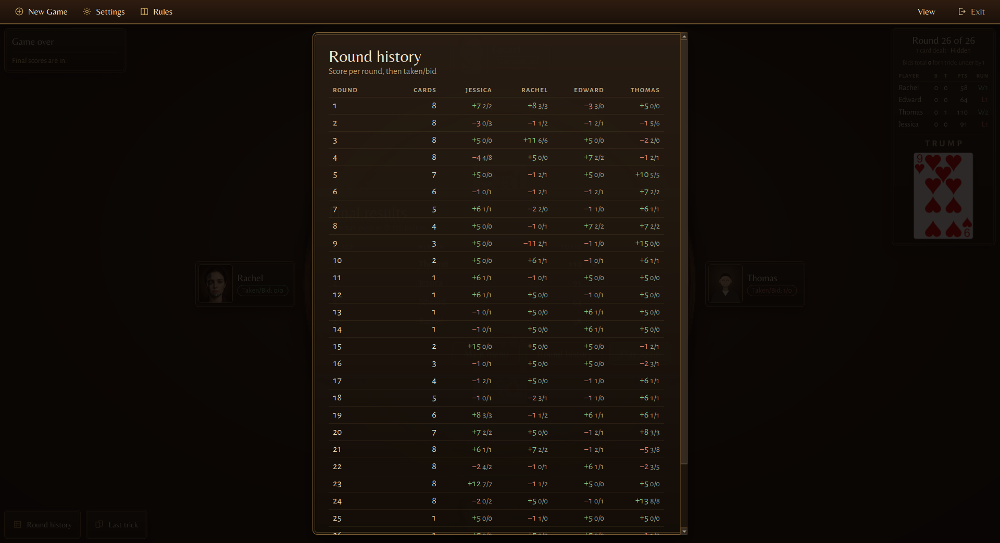</td>
  </tr>
  <tr>
    <td>Final results.</td>
    <td>Round history: each round's score, then tricks taken / bid.</td>
  </tr>
</table>

### Watching the computer play

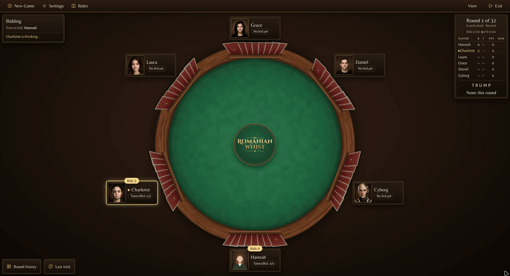

### In Romanian

The menus, the table, the scoreboard, the dialogs and the rules are all in Romanian.

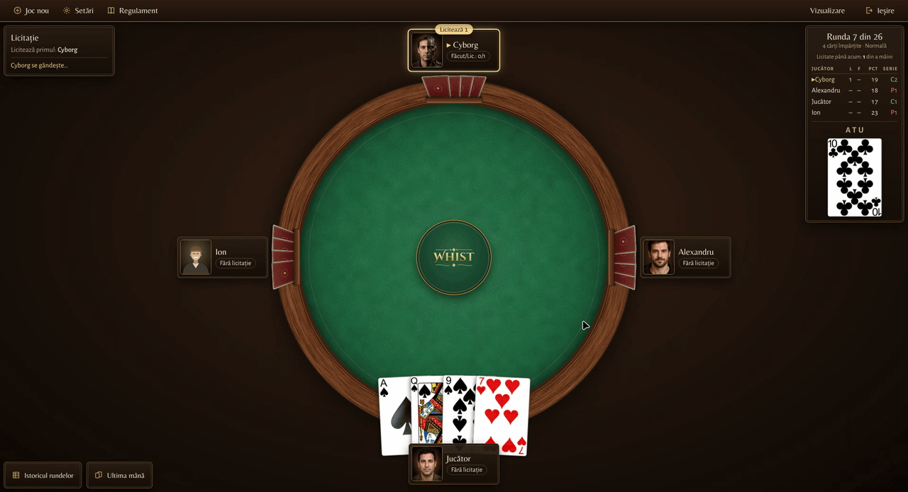

<table>
  <tr>
    <td width="50%">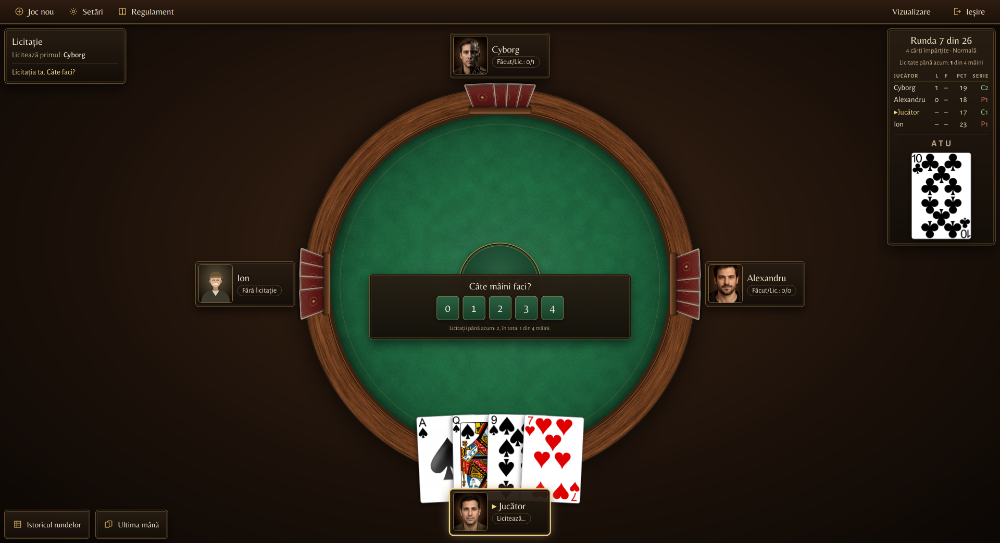</td>
    <td width="50%">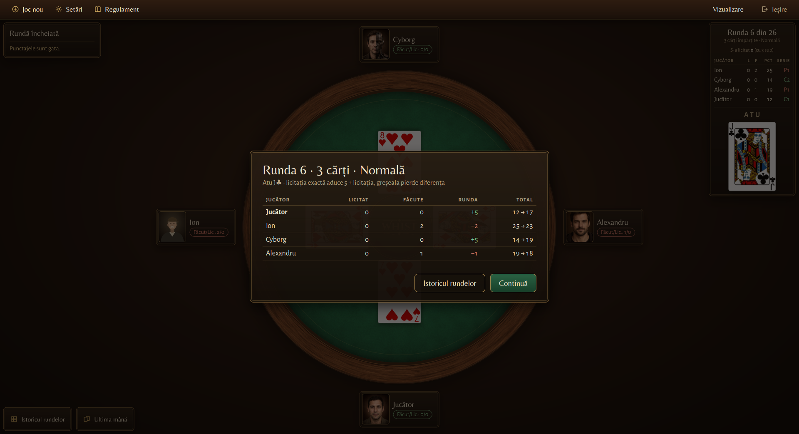</td>
  </tr>
  <tr>
    <td>Bidding (<i>Licitație</i>).</td>
    <td>The end-of-round summary.</td>
  </tr>
  <tr>
    <td>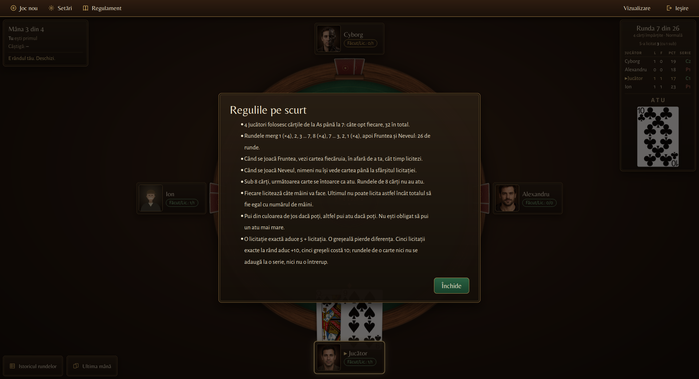</td>
    <td>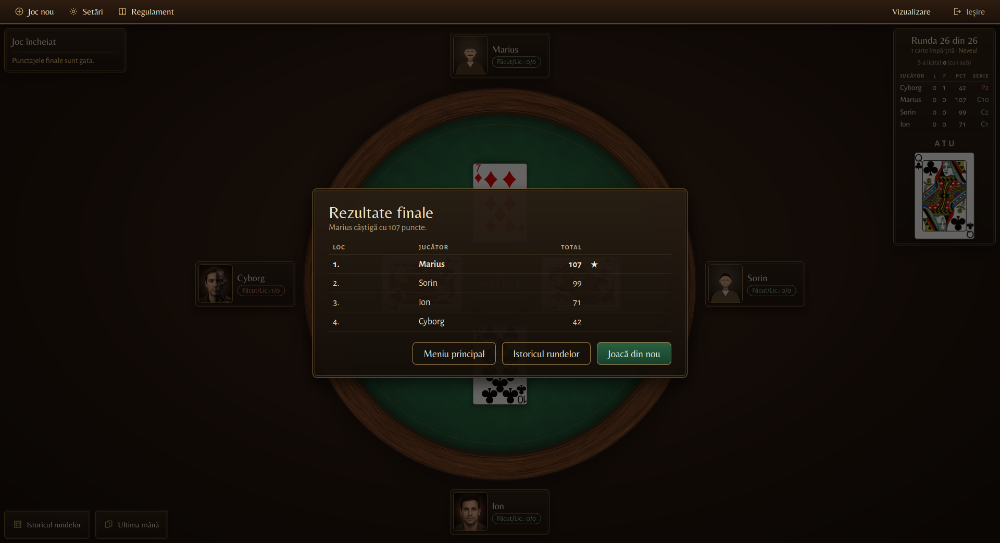</td>
  </tr>
  <tr>
    <td>The rules (<i>Regulile pe scurt</i>).</td>
    <td>Final results (<i>Rezultate finale</i>).</td>
  </tr>
</table>

## How to play

Each round, every player is dealt the same number of cards, and the next card off the deck is
turned up as trump (8-card rounds have no trump). Then everyone bids how many tricks they will
take. **The last bidder may not make the bids add up to the number of tricks**, so somebody is
always going to be wrong.

During play you must follow the suit that was led if you can. If you can't, you must play a trump
if you have one. The highest trump wins the trick, or the highest card of the suit led if no trump
was played.

| At the end of a round | Points |
|---|---|
| You took exactly what you bid | 5 + your bid |
| You missed | minus the difference |
| 5th exact bid in a row | +10 bonus |
| 5th miss in a row | −10 |

One-card rounds don't count towards those streaks. The highest total at the end of the game wins.

The full rules are under **Rules** in the app, and in the engine's
[rules document](https://github.com/conectionist/romanian_whist_engine/blob/master/docs/RULES.md).

## The computer players

| Opponent | How it plays |
|---|---|
| Random | Bids a random legal number and plays a random legal card. |
| First card | Bids 0 (or 1 when 0 is barred) and plays the first legal card in its hand. |
| Low risk | Bids the tricks its hand will take anyway, then wins them cheaply. |
| Ducking | Bids 0 no matter what, and gets rid of its high cards whenever they can't win. |
| Cyborg | Works out exact odds for every card, bids the count with the best expected score, and re-plans every trick. |
| Reckoner (Alpha) | Imagines no deals and plays by rule, but sometimes plays a random card. |
| Reckoner (Beta, Gamma, Delta) | Imagines possible deals before each card and plays what does best across them, counting part of every point an opponent scores against its own. Beta sometimes plays at random; Gamma and Delta never do. |

In the New Game dialog, hover over a choice in an opponent's list for the details.

## Download

Get the latest version from the [Releases page](https://github.com/conectionist/romanian_whist_desktop/releases/latest):

| System | File | To start it |
|---|---|---|
| Linux | `romanian_whist_desktop-<version>-linux.tar.gz` | Unpack it and run `bin/romanian_whist_desktop`. |
| Windows | `romanian_whist_desktop-<version>-windows.zip` | Unzip it and run `bin\romanian_whist_desktop.exe`. |
| macOS | `romanian_whist_desktop-<version>-macos.tar.gz` | Unpack it and open `romanian_whist_desktop.app`. |

Everything the game needs is in the archive; there is nothing to install. The builds aren't
code-signed, so Windows and macOS may warn you the first time you open them.

The game asks for a language when it starts. To skip the question, start it with
`--language en` or `--language ro`.

## Building from source

You need:

- a C++20 compiler (GCC, Clang or MSVC)
- CMake 3.21 or newer
- Qt 6.7 or newer, with the Widgets, Svg and Linguist Tools components

The game logic lives in the
[Romanian Whist engine](https://github.com/conectionist/romanian_whist_engine), which is a git
submodule, so clone with `--recurse-submodules`:

```bash
git clone --recurse-submodules https://github.com/conectionist/romanian_whist_desktop.git
cd romanian_whist_desktop
```

If you already cloned without it, run `git submodule update --init --recursive`.

Then configure, build and run. Point `CMAKE_PREFIX_PATH` at your Qt installation if CMake doesn't
find it by itself:

```bash
cmake --preset release -DCMAKE_PREFIX_PATH=/path/to/Qt/6.x/gcc_64
cmake --build --preset release
./build-release/romanian_whist_desktop
```

The `default` preset makes a debug build in `build/` instead. To run the tests:

```bash
ctest --preset release --output-on-failure
```

### Project layout

```
src/core/     game state as the window sees it, hand layout and card order
src/engine/   runs the engine on its own thread and passes moves and updates across
src/table/    the table: seats, cards, hands, tricks and the scoreboard
src/paint/    drawing: card faces, textures, fonts, shadows and the theme
src/ui/       main menu, New Game dialog, settings, rules, history and the other sheets
resources/    card art, table textures, fonts, portraits and player names
i18n/         the Romanian translation
tests/        Catch2 tests, and a tool that takes screenshots of the table
docs/         design notes, plans and the table redesign
```

## Related projects

- [romanian_whist_engine](https://github.com/conectionist/romanian_whist_engine): the game engine
  this client is built on. It holds the rules, the scoring and the computer players.
- [romanian_whist_terminal](https://github.com/conectionist/romanian_whist_terminal): the same game
  in a terminal.

## Credits

- **Card art:** [Vector Playing Cards](https://opengameart.org/content/playing-cards-vector-png)
  by Byron Knoll, released into the public domain.
- **Player portraits:** generated with AI image tools (ChatGPT, Meta AI, Lumo and Claude).
- **Fonts:** Alegreya Sans, Belleza and Cinzel Decorative, under the SIL Open Font License. Each
  font's licence is next to it in [resources/fonts/](resources/fonts/).

## License

The desktop client is licensed under the [GNU General Public License v3.0](LICENSE).

The engine it is built on is licensed under the
[GNU Affero General Public License v3.0](https://github.com/conectionist/romanian_whist_engine/blob/master/LICENSE).
