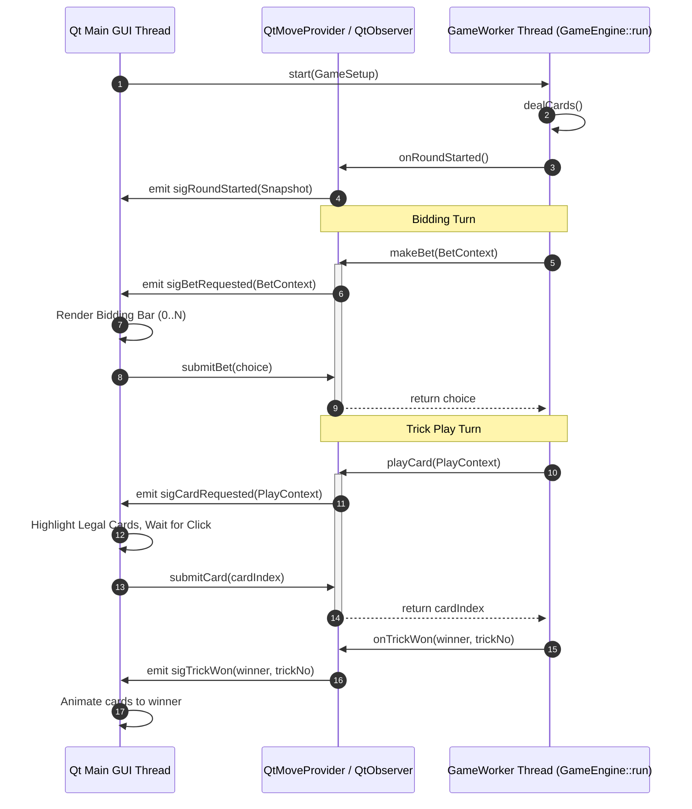
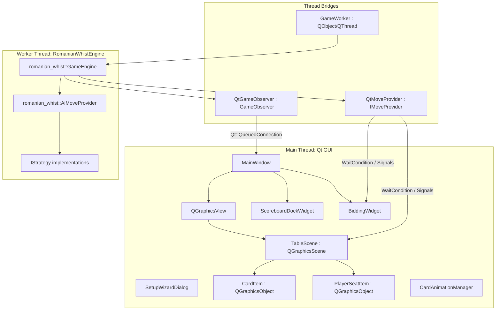

# Desktop GUI (Qt C++) Implementation Plan for Romanian Whist

This document specifies the complete visual design, software architecture, threading model, and implementation roadmap for building a native desktop Graphical User Interface (GUI) in **Qt 6 / C++20** that interfaces with the existing `RomanianWhistEngine`.

---

## 1. Executive Summary & Goals

The goal is to create a cross-platform desktop client (Linux, macOS, Windows) for Romanian Whist that offers:
1. **Modern, polished card table aesthetics**: Felt surface, SVG vector cards, smooth dealing/playing animations, glowing active turn indicators, and responsive seating (2–6 players).
2. **First-class Romanian Whist rule support**: Visual cues for trump cards, bidding restrictions (rule 5: barred bids), trick leader highlights, streak indicators (🔥 +10 / ❄️ -10), and special rounds (**Forehead** and **Hidden** modes).
3. **Clean, decoupled architecture**: The core game engine (`RomanianWhistEngine`) runs synchronously on a dedicated worker thread, communicating with the Qt main GUI thread via thread-safe signal/slot bridges without freezing the 60 FPS UI.
4. **Rich features**: Live round-by-round scoreboard matrix, setup wizard, game speed / pacing controls, replayable seeded games, and spectator/demo mode.

---

## 2. Visual & UX Design Specification

### 2.1 Table Layout & Player Seating (The Arena)

The primary view is an elliptical card table rendered in a 2D canvas (`QGraphicsView` / `QGraphicsScene`).

```
+------------------------------------------------------------------------------------+
|  [Round 5/21 | 5 Cards | 1-8-1 | Normal]            [Speed: [====*] | Pause | Menu]|
|------------------------------------------------------------------------------------|
|                                                                                    |
|                           +-----------------------+                                |
|                           |   [Avatar]  Elena     |                                |
|                           |   Tricks: 1 / 2       |                                |
|                           |   Score: 42 (🔥+3)    |                                |
|                           +-----------------------+                                |
|                                                                                    |
|     +--------------------+                         +--------------------+          |
|     |  [Avatar] Radu     |        [ TRICK AREA ]   |  [Avatar] Maria    |          |
|     |  Tricks: 0 / 1     |         +----+  +----+  |  Tricks: 2 / 2     |          |
|     |  Score: 35         |         |♠10 |  |♠ K*|  |  Score: 50 (🔥+4)  |          |
|     +--------------------+         +----+  +----+  |  +-----------------+          |
|                                    +----+  +----+  |                               |
|                                    |♠ 8 |  |♥ A |  |                               |
|                                    +----+  +----+  |                               |
|                                                    |                               |
|                           [Trump: ♦9] [Deck: 18]   |                               |
|                                                                                    |
|  +------------------------------------------------------------------------------+  |
|  | [Bidding Bar] (Betting Phase): [ 0 ] [ 1 ] [ 2 ] [ 3 ] [ X ](Barred: 4) [ 5 ] |  |
|  +------------------------------------------------------------------------------+  |
|                                                                                    |
|                               [ YOUR HAND ]                                        |
|                     +----+  +----+  +----+  +----+  +----+                         |
|                     |♠ 7 |  |♥ 9 |  |♦ J |  |♦ Q |  |♣ A |                         |
|                     |    |  |    |  |    |  |    |  |    |                         |
|                     +----+  +----+  +----+  +----+  +----+                         |
|                     (dim)   (dim)   [Play]  [Play]  (dim)                          |
|                     Hint: Lead is ♦. You must follow Diamond.                      |
|                                                                                    |
|  [Score: 48 (🔥+2)]   [Tricks: 1 / 3]   [Your Turn: Play a Card]                   |
+------------------------------------------------------------------------------------+
```

#### Dynamic Seating Algorithm (2 to 6 Players)
Players are placed along an ellipse centered at $(X_c, Y_c)$ with radii $(R_x, R_y)$:
- **Human Player**: Always pinned to the **Bottom Center** ($\theta = \frac{3\pi}{2}$ or $270^\circ$).
- **Opponents**: Distributed evenly along the top and sides of the oval.
- **Seat Angles**:
  - **2 Players**: Human (Bottom), Bot 1 (Top).
  - **3 Players**: Human (Bottom), Bot 1 (Top-Left), Bot 2 (Top-Right).
  - **4 Players**: Human (Bottom), Bot 1 (Left), Bot 2 (Top), Bot 3 (Right).
  - **5 Players**: Human (Bottom), Bot 1 (Bottom-Left), Bot 2 (Top-Left), Bot 3 (Top-Right), Bot 4 (Bottom-Right).
  - **6 Players**: Human (Bottom), Bot 1 (Bottom-Left), Bot 2 (Top-Left), Bot 3 (Top), Bot 4 (Top-Right), Bot 5 (Bottom-Right).

---

### 2.2 Visual Elements & Components

#### 1. Player Seat Badge (`PlayerSeatItem`)
- **Avatar & Name**: Distinct avatar icons with clear name labels.
- **Active Turn Indicator**: Pulsing golden border glow when `getActiveSeat() == seat`.
- **Status Pill**:
  - During Bidding: Shows `Thinking...` or `Bid: [N]`.
  - During Play: Shows `Tricks: [Won] / [Bid]` (e.g. `2 / 3`). Color-coded:
    - *Green*: Bet met exactly (`tricksWon == bet`).
    - *Yellow*: Under bet with tricks remaining.
    - *Red*: Over bet (`tricksWon > bet`).
- **Streak Counters**: Badge for 5-trick bonus streaks (🔥 `+1` to `+4` / ❄️ `-1` to `-4`).
- **Score Tag**: Total score and projected round delta (e.g. `45 (+8)`).

#### 2. Center Trick Arena (`TrickAreaItem`)
- Played cards fly smoothly from the player seat to the center table with slight radial fanning.
- **Winning Card Highlight**: Subtle golden halo around the card currently winning the trick (`getCurrentTrickLeader()`).
- **Trick Conclusion Banner**: Pops up showing `"Maria wins the trick with ♠A"`, holds for the pacing duration, and sweeps cards toward Maria's seat.

#### 3. Trump & Round HUD (`TrumpBadgeItem` & `HeaderBar`)
- **Round Info**: `Round 7 of 21 | 7 Cards | Structure: 1-8-1`.
- **Trump Card**: Turned card face-up beside the deck. In 8-card rounds, displays a styled `"NO TRUMP"` shield badge.
- **Special Round Banners**:
  - **Forehead Round**: Amber badge `"FOREHEAD ROUND: Opponent hands visible, yours hidden!"`
  - **Hidden Round**: Purple badge `"HIDDEN ROUND: All hands hidden during bidding!"`

#### 4. Human Hand Ribbon (`HandViewItem`)
- **Card Styling**: High-resolution SVG vector cards with crisp rank/suit indices and standard/4-color deck toggle.
- **Interactivity**:
  - **Hover**: Card rises by 20px with drop-shadow effect.
  - **Legal Cards**: Fully lit, selectable via click or drag-and-drop.
  - **Illegal Cards**: Dimmed (60% opacity) with a disabled cursor; clicking shows a brief shake animation and a hint (e.g. *"Must follow Diamond"* or *"Must play Trump"*).
  - **Keyboard Shortcuts**: Number keys `1`..`N` or Left/Right arrows + Enter to play.

#### 5. Interactive Bidding Bar (`BiddingWidget`)
- Floats just above the player's hand during the bidding phase.
- Horizontal pill buttons for bids `0`, `1`, `2`, ..., `N` (hand size).
- **Barred Bid (Rule 5)**: If the human is the final bidder and a bid equals $N - \sum \text{bets}$, that button is disabled, styled in red with a strikethrough and a badge: `"Barred: Sum cannot equal trick count"`.

#### 6. Forehead & Hidden Mode Rendering
- **Forehead Rounds**: Opponents' cards are displayed face-up floating above their seat badges (since the rule allows seeing all other hands). The human's card is displayed face-down.
- **Hidden Rounds**: All cards are displayed face-down until bidding finishes.

---

### 2.3 Scoreboard & Statistics Drawer (`ScoreboardDockWidget`)

A dockable / collapsible side panel providing standard Romanian Whist scoring matrices:

| Round | Cards | Trump | Dan (You) | Elena (Bot) | Radu (Bot) | Maria (Bot) |
|:-----:|:-----:|:-----:|:---------:|:-----------:|:----------:|:-----------:|
| 1 | 1 | ♠ | **1 / 1 (+6)** | 0 / 0 (+5) | 1 / 0 (-1) | 0 / 0 (+5) |
| 2 | 1 | ♥ | 0 / 0 (+5) | 1 / 1 (+6) | 0 / 0 (+5) | 1 / 0 (-1) |
| ... | ... | ... | ... | ... | ... | ... |
| **Total** | | | **48** (🔥+2) | **42** (🔥+1) | **35** | **50** (🔥+4) |

- **Highlights**: Exact bids shown in green, missed bids in red, streak bonuses (`+10`/`-10`) highlighted with star icons.
- **Standings Tab**: Shows competition rank (`Standing::place`), tie handling, and win rates.
- **Event Log Tab**: Real-time log of every bid, lead, trick play, and round score.

---

### 2.4 Dialogs & Setup Wizard

```
+-------------------------------------------------------------+
|                      NEW GAME SETUP                         |
+-------------------------------------------------------------+
|  Game Mode:     (o) Play as Human      ( ) Spectator Mode   |
|  Your Name:     [ Dan                    ]                  |
|  Players:       [ 4 Players            v ]                  |
|                                                             |
|  Seats Configuration:                                       |
|    Seat 1 (You):   Dan                 [ Human ]            |
|    Seat 2:         Elena               [ AI: LowRisk     v] |
|    Seat 3:         Radu                [ AI: Ducking     v] |
|    Seat 4:         Maria               [ AI: FirstCard   v] |
|                                                             |
|  Game Rules & Structure:                                    |
|    Structure:      (o) 1-8-1 (Classic)    ( ) 8-1-8         |
|    [x] End with Forehead and Hidden rounds                  |
|    [ ] Play all 1-card rounds as Forehead                   |
|                                                             |
|  Advanced:                                                  |
|    [ ] Fixed Shuffle Seed: [ 123456     ]                   |
|                                                             |
|                 [ Cancel ]       [ Start Game ]             |
+-------------------------------------------------------------+
```

---

## 3. Architecture & Technical Design

### 3.1 Concurrency & Threading Model

The `GameEngine::run()` loop is synchronous and blocking. It must run on a background `QThread` (`GameWorker`), while `QApplication` runs on the main thread.



#### Thread Synchronization Mechanism
1. **Engine to GUI (`IGameObserver` -> `QtGameObserver`)**:
   - `QtGameObserver` implements `romanian_whist::IGameObserver`.
   - In each callback, it extracts data into lightweight, copyable value structs (`GameStateSnapshot`, `RoundScoreSummary`, etc.) and emits Qt signals with `Qt::QueuedConnection`.
   - The main GUI thread handles these signals in slots to update the UI without race conditions.

2. **GUI to Engine (`QtMoveProvider` -> `IMoveProvider`)**:
   - `QtMoveProvider` implements `romanian_whist::IMoveProvider`.
   - When `makeBet(context)` or `playCard(context)` is called on the worker thread:
     1. It emits `sigBetRequested` or `sigCardRequested` to the GUI thread.
     2. It blocks the worker thread using a `QWaitCondition` paired with a `QMutex` (or `std::promise`/`std::future`).
     3. When the player clicks a bid button or card, the UI invokes `submitBet(unsigned int)` / `submitCard(size_t)`.
     4. The provider stores the selection and wakes the worker thread via `QWaitCondition::wakeAll()`.
     5. The worker thread unblocks and returns the value to `GameEngine`.

3. **Interruption & Clean Shutdown**:
   - If the user quits or starts a new game while `GameEngine::run()` is active:
     - The UI calls `GameEngine::requestStop()` (which sets the `std::atomic<bool> stopRequested`).
     - If `QtMoveProvider` is currently blocked waiting for human input, the UI triggers `cancelPendingWait()`, waking the worker thread and throwing a lightweight `GameCancelledException` or returning `std::nullopt` to let the thread exit cleanly.

4. **Pacing & Animation Timing**:
   - For AI moves, the UI needs brief visual pauses so the user can observe plays.
   - Pacing is managed via a configurable delay token (`QWaitCondition::wait(delayMs)` in `QtGameObserver` on the worker thread) or via an animation queue on the GUI thread.

---

### 3.2 Component Breakdown



---

## 4. Proposed Codebase Structure

We will create a new directory `src/gui/` structured as follows:

```
src/gui/
├── CMakeLists.txt
├── main.cpp                        # GUI Application entry point
├── resources/
│   ├── cards/                      # SVG card deck assets (52 cards + back + joker)
│   ├── icons/                      # App icons, trump glyphs, avatars
│   ├── styles/                     # QSS stylesheets (dark slate / green felt)
│   └── whist_gui.qrc               # Qt Resource definition
├── core/
│   ├── GameStateSnapshot.h         # Value types passed across threads
│   ├── GameWorker.h / .cpp         # QThread worker owning GameEngine
│   ├── QtGameObserver.h / .cpp     # IGameObserver -> Qt Signals bridge
│   ├── QtMoveProvider.h / .cpp     # IMoveProvider <- Qt Slots bridge
│   └── GuiPacer.h / .cpp           # Configurable turn & trick delay manager
├── scene/
│   ├── TableScene.h / .cpp         # QGraphicsScene representing the table
│   ├── CardItem.h / .cpp           # Interactive 2D Card Graphic Object
│   ├── PlayerSeatItem.h / .cpp     # Player Avatar, Bet/Trick Badge, Streaks
│   ├── TrickAreaItem.h / .cpp      # Central Trick layout & winner animations
│   ├── TrumpBadgeItem.h / .cpp     # Turned Trump card indicator
│   └── CardAnimationManager.h/.cpp # Dealing, playing, and trick sweeping transitions
├── widgets/
│   ├── MainWindow.h / .cpp         # Top-level window, menus, toolbar
│   ├── BiddingWidget.h / .cpp      # Dynamic 0..N bidding bar overlay
│   ├── ScoreboardDock.h / .cpp     # Live score sheet & standings table
│   ├── ScoreTableModel.h / .cpp    # QAbstractTableModel for Romanian Whist matrix
│   └── GameHistoryView.h / .cpp    # Event log widget
└── dialogs/
    ├── SetupWizardDialog.h / .cpp  # Game options & player configuration
    ├── RoundSummaryDialog.h / .cpp # Inter-round score & streak recap
    ├── GameOverDialog.h / .cpp     # Podium & final standings celebration
    └── SettingsDialog.h / .cpp     # Animation speed, 4-color deck, theme
```

---

## 5. CMake Build Integration

The root `CMakeLists.txt` will be updated to optionally build the GUI client (`whist_gui`):

```cmake
# Root CMakeLists.txt addition:
option(WHIST_BUILD_GUI "Build the Qt GUI client" ON)

if(WHIST_BUILD_GUI)
    find_package(QT NAMES Qt6 Qt5 REQUIRED COMPONENTS Core Gui Widgets Svg)
    find_package(Qt${QT_VERSION_MAJOR} REQUIRED COMPONENTS Core Gui Widgets Svg)
    add_subdirectory(src/gui)
endif()
```

And in `src/gui/CMakeLists.txt`:
```cmake
set(CMAKE_AUTOMOC ON)
set(CMAKE_AUTORCC ON)
set(CMAKE_AUTOUIC ON)

add_executable(whist_gui
    main.cpp
    resources/whist_gui.qrc
    core/GameWorker.cpp
    core/QtGameObserver.cpp
    core/QtMoveProvider.cpp
    core/GuiPacer.cpp
    scene/TableScene.cpp
    scene/CardItem.cpp
    scene/PlayerSeatItem.cpp
    scene/TrickAreaItem.cpp
    scene/TrumpBadgeItem.cpp
    scene/CardAnimationManager.cpp
    widgets/MainWindow.cpp
    widgets/BiddingWidget.cpp
    widgets/ScoreboardDock.cpp
    widgets/ScoreTableModel.cpp
    widgets/GameHistoryView.cpp
    dialogs/SetupWizardDialog.cpp
    dialogs/RoundSummaryDialog.cpp
    dialogs/GameOverDialog.cpp
    dialogs/SettingsDialog.cpp
)

target_compile_features(whist_gui PUBLIC cxx_std_20)

target_link_libraries(whist_gui PRIVATE
    RomanianWhist::engine
    Qt${QT_VERSION_MAJOR}::Core
    Qt${QT_VERSION_MAJOR}::Gui
    Qt${QT_VERSION_MAJOR}::Widgets
    Qt${QT_VERSION_MAJOR}::Svg
)
```

---

## 6. Implementation Roadmap

### Phase 1: Engine Bridge & Threading Core
- Implement `GameStateSnapshot` data models.
- Implement `QtGameObserver` with full Qt signal emission for all engine events.
- Implement `QtMoveProvider` with thread synchronization (`QWaitCondition`/`QMutex`).
- Implement `GameWorker` managing the background `GameEngine::run()` loop.
- Unit tests validating the multi-threaded move provider & observer lifecycle with `QTest`.

### Phase 2: Graphic Scene & Vector Card Assets
- Integrate SVG card deck into Qt resources (`whist_gui.qrc`).
- Implement `CardItem` with vector rendering, front/back switching, hover effects, and selection.
- Implement `PlayerSeatItem` with dynamic radial layout for 2 to 6 seats.
- Implement `TableScene` with felt texture, trump display, and trick area.

### Phase 3: Interaction & Game Flow
- Implement `BiddingWidget` with forbidden-bid validation and tooltip explanations.
- Implement card play interactions (click/drag validation using `CardValidator`).
- Implement `CardAnimationManager` for dealing, playing to trick, and sweeping tricks to winners.
- Connect `QtMoveProvider` to UI input widgets.

### Phase 4: Scoreboard, Special Rounds & Dialogs
- Implement `ScoreTableModel` and `ScoreboardDock` (round-by-round score grid).
- Implement `SetupWizardDialog` (game structure, AI strategies, seeds).
- Implement Forehead and Hidden round visual modes.
- Implement `RoundSummaryDialog` and `GameOverDialog` podium.

### Phase 5: Polish & Accessibility
- Add 4-color card deck toggle (♠ Black, ♥ Red, ♦ Blue, ♣ Green).
- Add game pacing controls (Instant, Fast, Normal, Slow).
- Add keyboard accessibility (numbers `1`..`N`, arrows, Enter, Space).
- Packaging and cross-platform CMake presets.

---

## 7. Verification Plan

### Automated Verification
- **Unit Tests (`tests/GuiBridgeTests.cpp`)**: Test `QtMoveProvider` waiting and waking mechanisms, timeout handling, and cancellation behavior under `QTest`.
- **Headless Bot Simulation**: Run `whist_gui --demo --seed=42 --no-gui` to verify 100 complete simulated games without deadlock or crashes.

### Manual UI Verification
- **2 to 6 Players Layout Check**: Test table arrangement across 2, 3, 4, 5, and 6 players to verify text spacing and seat alignment.
- **Rule 5 Verification**: Enter bidding as the last player in round 1..8 and verify that the forbidden bet button is disabled with the correct reason.
- **Special Round Visuals**: Play a game with Forehead/Hidden enabled and verify that opponent cards are visible in Forehead while human's is hidden.
- **Resize & DPI Scaling**: Test window resizing from 1024x768 to 4K resolution on high-DPI displays.
